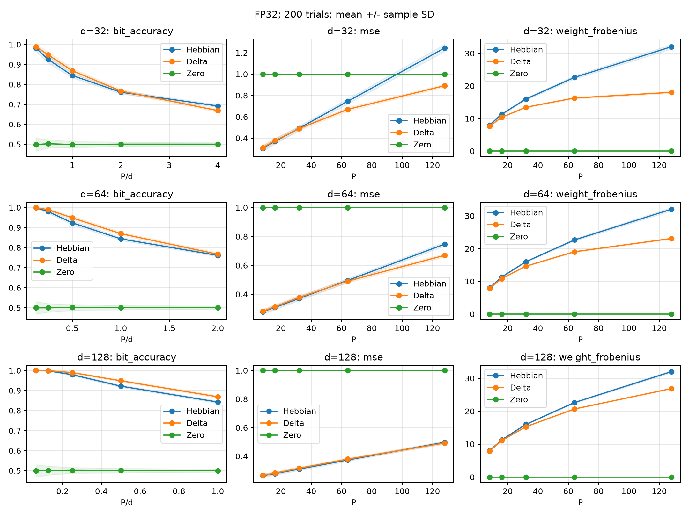

# 实验一：单遍写入与完整线索检索

从仓库根目录运行以下命令。Hebbian、Delta 和零矩阵使用同一批随机键值，逐对写入一次，写完后用完整线索检索。键维数为 32、64、128，记忆数为 8、16、32、64、128，内容维数为 32，学习率为 0.5。每个组合独立重复 200 次。

```shell
uv run --locked --extra cpu python -m associative_memory.experiment1.run
```

左列显示比特正确率随记忆负载 P/d 的变化，中列和右列分别显示均方误差和权重 Frobenius 范数随记忆数 P 的变化。每行对应一个键维数，阴影表示 200 次重复的样本标准差。[逐条件数据](../output/experiment1/experiment1_summary.csv)



## 课堂汇报中的三个问题

| 问题 | 在本次实验中观察到什么 |
| --- | --- |
| 其他记忆为什么会干扰检索？提高维数要付出什么代价？ | 不同线索的内积可能非零。更新共享矩阵时，新记忆会改变与其线索重叠的旧记忆读出。固定存 32 对，将键维数从 32 提高到 128，Delta 的正确率从 86.88% 升至 98.97%，FP32 权重从 4 KiB 增至 16 KiB。 |
| 权重更大是否等于记得更好？ | 在 d = 64、P = 64 时，Hebbian 的平均权重范数为 22.63，正确率为 84.37%。Delta 的权重范数较小（19.03），正确率更高（86.98%）。 |
| Hebbian 与 Delta 写入有何区别？ | Hebbian 直接叠加目标与线索的外积，Delta 根据目标与当前读出的误差更新。在 d = 64、P = 128 时，Delta 对最早和最晚各 32 对的正确率分别为 66.09% 和 90.53%，Hebbian 对这两组的正确率为 76.14% 和 76.09%。 |

[下载一页课堂汇报（PPTX）](../output/experiment1/briefing/experiment1.pptx) · [查看汇报预览（PNG）](../output/experiment1/briefing/experiment1.png)

## 实现核对与论文对照

- 相同种子下的 NumPy FP64 与 PyTorch FP32 结果逐条件列出了比特翻转数和连续读出差值。[实现对照表](../output/experiment1/experiment1_comparison.csv) · [对照图](../output/experiment1/experiment1_comparison.png) · [生成这组对照的原始代码](https://github.com/LevelDownRefine/neural-network-teaching/blob/d4e25a6fe449bbe2c45759ce92cc284ab46951c6/associative_memory/experiment1/compare.py)
- 扩展实验用论文作者的固定门值 Preconditioned DeltaNet 写入函数与作业 Delta 比较检索正确率和写入内存。[论文方法、复现命令与结果](paper_comparison.md)
