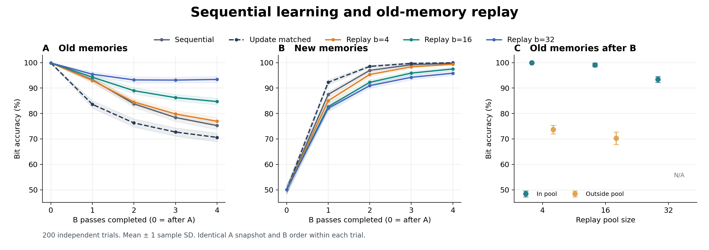

# 探索性研究任务：学新会不会忘旧，回放能否改善？

使用小组的 [公共关联记忆模型](https://github.com/LevelDownRefine/neural-network-teaching/tree/74948f8c8224587a06c136f8a6f12c3ca59d1a60/associative_memory)。记忆存在 32×64 的权重矩阵 W 中，给定线索 k，计算 Wk 并取符号来恢复 32 位内容。用 Delta 规则逐对更新 W，学习率 0.5。

每次生成独立的 A、B 两批随机配对，各 32 条。先打乱学习 A 四遍，再从同一 A 权重快照出发，按相同的 B 顺序执行五组对照。依次记录 A 学完、B 每学完一遍时的逐比特正确率。回放池从 A 中无放回随机选取，回放时有放回抽样。200 次独立试验，根随机种子为 42。

## 学习结果

| 条件 | A 学完时 A | A 学完时 B | B 学完时 A | B 学完时 B |
|---|---:|---:|---:|---:|
| 顺序学习：每条 B 更新一次 | 99.88% | 50.02% | 75.25% | 99.75% |
| 次数匹配：每条 B 连续更新两次 | 99.88% | 50.02% | 70.60% | 99.94% |
| 每条 B 后回放一条 A，池容量 4 | 99.88% | 50.02% | 76.97% | 99.35% |
| 每条 B 后回放一条 A，池容量 16 | 99.88% | 50.02% | 84.70% | 97.50% |
| 每条 B 后回放一条 A，池容量 32 | 99.88% | 50.02% | 93.39% | 95.83% |



前两图的横轴 0 表示刚学完 A，1–4 表示学完 B 的遍数。右图比较 B 学完后进入回放池与未进入回放池的 A 样本。阴影和误差棒表示 200 次试验的均值 ± 一个样本标准差。

| 回放容量 | A 池内正确率 | A 池外正确率 | 相对次数匹配组，A 的差值 | 相对次数匹配组，B 的差值 |
|---:|---:|---:|---:|---:|
| 4 | 约 100% | 73.68% | +6.37 个百分点 | −0.59 个百分点 |
| 16 | 99.11% | 70.28% | +14.09 个百分点 | −2.44 个百分点 |
| 32 | 93.39% | 不适用 | +22.79 个百分点 | −4.11 个百分点 |

A、B 使用同一权重矩阵，随机线索一般并不正交。写入 B 会同时改变部分 A 的读出，造成遗忘。三种容量下，回放都比同为 256 次更新的对照保留了更多 A。容量越大，平均 A 正确率越高，B 正确率则有所下降。小池频繁重复少数旧样本，因此池内表现很高，池外仍容易忘。容量扩大后，同样 128 次 A 回放覆盖更多旧样本，每条得到的重复次数也更少。

## 明确结论

1. **学习 B 会遗忘 A。** A 学完时的 A 正确率为 99.88%。B 学完四遍后，普通顺序学习的 A 正确率降至 75.25%，同时 B 达到 99.75%。
2. **回放确实改善旧记忆，而且收益不只是更新次数变多。** 与同样进行 256 次 B 阶段更新的匹配对照相比，回放池容量为 4、16、32 时，A 正确率分别提高 6.37、14.09、22.79 个百分点。匹配对照仅重复更新 B，A 正确率为 70.60%，比普通顺序学习的 75.25% 更低。
3. **回放主要保护进入池的旧记忆。** 容量 16 时，池内 A 正确率为 99.11%，池外只有 70.28%，该子集与匹配对照的全部 A 并非同一比较对象，不能据此判断池外样本相对对照变好或变差。容量 32 时全部 A 都在池内，池外评分不适用。不能把总体 A 正确率的提高解释为所有旧记忆均得到同等保护。
4. **收益伴随新记忆表现和存储成本的代价。** 容量 32 时 A 保留达到 93.39%，B 正确率为 95.83%，低于匹配对照的 99.94%；回放池额外保存 3,072 个 FP32 标量，占 12,288 字节。三种回放容量都执行相同的 256 次 B 阶段更新，容量变化影响的是保存与抽到哪些 A 配对，而非总更新次数。

这些结论是固定参数、随机独立配对和 200 次试验下的平均结果，不表示任意一组具体配对都具有相同幅度的收益。

## 更新与存储成本

| 条件 | A 更新次数 | B 阶段更新次数 | 合计 | 回放池标量 | 回放池字节 | 权重与回放池合计字节 |
|---|---:|---:|---:|---:|---:|---:|---:|
| 顺序学习 | 128 | 128 | 256 | 0 | 0 | 8,192 |
| 次数匹配 | 128 | 256 | 384 | 0 | 0 | 8,192 |
| 回放 4 | 128 | 256 | 384 | 384 | 1,536 | 9,728 |
| 回放 16 | 128 | 256 | 384 | 1,536 | 6,144 | 14,336 |
| 回放 32 | 128 | 256 | 384 | 3,072 | 12,288 | 20,480 |

权重恒为 2,048 个 FP32 标量，实际占 8,192 字节。每条回放记录由 64 维线索和 32 维内容组成，占 384 字节。表中是张量实际数据字节，统计范围是权重与回放池，不包括评估数据和临时张量。回放组在 B 阶段执行 128 次 B 更新与 128 次 A 更新。

## 复现与数据

在仓库根目录运行。实验在 CPU 上完成，默认重复 200 次，根随机种子为 42。

```bash
uv run --locked --extra cpu python -m associative_memory.exploration_replay.run 
```

- [实验脚本](run.py)调用仓库的 `ModelMemory`、`DeltaTrainer`、`train_epoch` 和 `generate_pairs`。
- [检查点汇总](../output/exploration_replay/accuracy_summary.csv)包含均值、样本标准差和每阶段更新次数。准确率列以 0–1 表示。
- [逐次试验](../output/exploration_replay/accuracy_by_trial.csv)包含每次试验的 25 个检查点。
- [更新与存储统计](../output/exploration_replay/update_and_storage_cost.csv)记录各条件的实际张量字节与更新次数。
