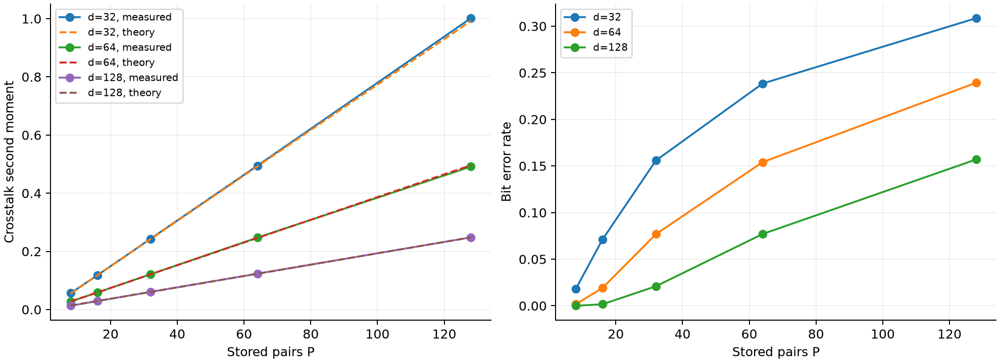
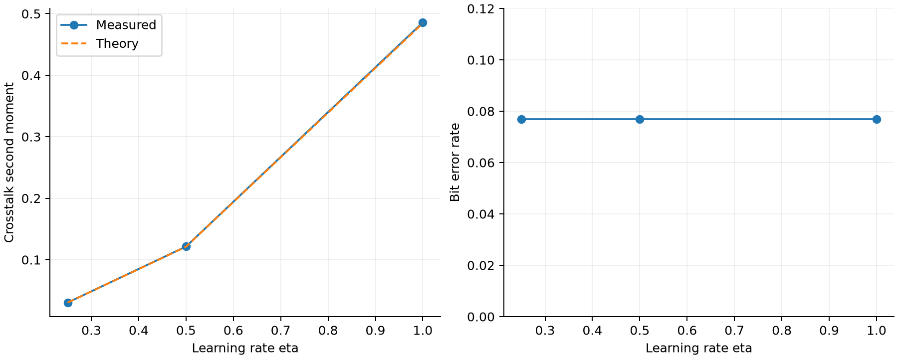
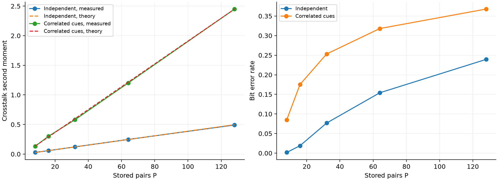

# 方向 C：推导并验证记忆串扰

## 设置与复现

使用单遍 Hebbian 写入，线索 `k ∈ {−1/√d,+1/√d}^d`，内容 `v ∈ {−1,+1}^32`，初始 `W=0`。默认学习率 `η=0.5`。独立线索实验遍历 `d=32,64,128` 和 `P=8,16,32,64,128`，每个组合使用 80 个独立随机种子 1000–1079。写入规则与仓库当前的 `ModelMemory`、`HebbianTrainer`、`train_epoch` 对照验证；大规模统计使用完全等价的单遍闭式解 `W=ηVᵀK`。

扩展实验固定 `d=64`，令所有线索由同一个随机原型产生，逐坐标独立以 25% 概率翻转；不同内容仍独立随机生成。此时两条线索的期望内积为 `ρ=(1−2×0.25)²=0.25`。相关组与独立组使用相同的种子编号、负载、维数和学习率。

运行命令：

```powershell
python -m associative_memory.option_3.run
python -m associative_memory.option_3.build_report
```

`results/individual_runs.csv` 保存每个种子的指标，`results/summary.csv` 保存跨种子均值和样本标准差，`results/config.json` 保存全部参数和依赖版本。图像均独立保存在 `results/`。

## 推导

对第 `μ` 条记忆检索，单遍 Hebbian 权重及读出为

```text
W = η Σ_{ν=1}^P v^ν (k^ν)ᵀ
z^μ = W k^μ = η v^μ + η Σ_{ν≠μ} v^ν [(k^ν)ᵀ k^μ]
```

目标项是 `ηv^μ`；第二项记为串扰 `ε^μ`。因为每条线索范数为 1，目标项系数恰为 `η`。独立、无偏的随机线索满足 `E[(k^ν)ᵀk^μ]=0`、`E{[(k^ν)ᵀk^μ]²}=1/d`。不同内容比特也独立且均值为零，交叉项在总体期望中消失。因此，对任一内容比特：

```text
E[ε_j] = 0
Var(ε_j) = E[ε_j²] = η² (P−1) / d
```

理论预测串扰方差随 `P−1` 线性增长，随 `d` 反比下降，随 `η²` 增长。本实验用所有查询和内容比特的 `mean(ε²)` 估计总体方差，并同时报告 `mean(ε)`；二阶矩与中心方差相差 `mean(ε)²`。

对相关线索，任意两条线索逐坐标的乘积均值为 `ρ=0.25`。坐标之间独立，因此 `E{[(k^ν)ᵀk^μ]²}=ρ²+(1−ρ²)/d`。内容仍独立且均值为零，于是串扰均值仍为零，但方差改为：

```text
Var_corr(ε_j) = η² (P−1) [ρ² + (1−ρ²)/d]
```

这里的相关性是由原型和独立翻转生成的，公式针对这种构造。

## 独立线索：理论与实测

下表固定 `d=64、η=0.5`。`E[ε²]` 为跨 80 个种子的平均二阶矩。MSE 以目标内容 `v` 为基准，错误率由 `sign(z)` 与 `v` 比较。

| P | 方差理论值 | E[ε²] 实测 | 读出 MSE | 比特错误率 |
|---:|---:|---:|---:|---:|
| 8 | 0.0273 | 0.0277 | 0.2795 | 0.17% |
| 16 | 0.0586 | 0.0582 | 0.3099 | 1.90% |
| 32 | 0.1211 | 0.1214 | 0.3719 | 7.68% |
| 64 | 0.2461 | 0.2471 | 0.4926 | 15.41% |
| 128 | 0.4961 | 0.4914 | 0.7431 | 23.93% |



`d=32、64、128` 三组曲线均随负载上升；同一负载下，增大 `d` 降低串扰。理论虚线和实测曲线贴近。`d=64` 时，从 `P=8` 增至 `P=128`，实测二阶矩从 0.0277 增至 0.4914，比特错误率从 0.17% 升至 23.93%。

学习率缩放检查固定 `P=32、d=64`，在相同随机种子和数据生成过程下比较三个学习率。

| η | 理论方差 | E[ε²] 实测 | 比特错误率 |
|---:|---:|---:|---:|
| 0.25 | 0.0303 | 0.0304 | 7.68% |
| 0.50 | 0.1211 | 0.1214 | 7.68% |
| 1.00 | 0.4844 | 0.4857 | 7.68% |



学习率从 0.25 加到 1.0，实测串扰二阶矩精确按四倍、十六倍缩放；比特错误率保持不变。这是因为零初始、单遍 Hebbian 的整个读出都乘以正数 `η`，改变幅值不会改变符号。连续读出误差与比特错误率由此不能混为一谈。

## 相关线索：独立假设失效

下表固定 `d=64、η=0.5`。相关组的理论列使用上述相关线索公式。

| P | 独立组方差实测 | 相关组方差实测 | 相关组方差理论 | 独立组错误率 | 相关组错误率 |
|---:|---:|---:|---:|---:|---:|
| 8 | 0.0277 | 0.1315 | 0.1350 | 0.17% | 8.51% |
| 16 | 0.0582 | 0.3006 | 0.2893 | 1.90% | 17.55% |
| 32 | 0.1214 | 0.5809 | 0.5979 | 7.68% | 25.31% |
| 64 | 0.2471 | 1.2016 | 1.2151 | 15.41% | 31.81% |
| 128 | 0.4914 | 2.4505 | 2.4495 | 23.93% | 36.78% |



在 `P=32` 时，相关组的串扰二阶矩是独立组的 4.78 倍，比特错误率由 7.68% 升至 25.31%。沿用独立公式会预测 0.1211，明显低于相关组的实测值；相关线索公式预测 0.5979，与实测值同量级。线索相关时，其他记忆的键与目标键持续重叠，造成额外串扰。

## 明确结论与边界

1. 独立无偏线索、内容及单遍 Hebbian 写入下，每个输出比特的串扰方差是 `η²(P−1)/d`。跨 80 个种子的负载、维数和学习率扫描与该公式吻合。

2. 相关线索破坏了 `1/d` 的原始重叠二阶矩。对于本实验的共享原型构造，串扰方差包含 `ρ²` 项；在固定相关程度下单纯增大 `d`，这一项不会消失。

3. 串扰增大通常伴随比特错误增多，但两者是不同指标。改变正学习率使连续串扰幅值按 `η` 变化，却不改变本实验的比特错误率。这里的 MSE 以原始内容 `v` 为目标，串扰方差则以 `ηv` 为目标，两个误差口径不同。

4. 这也解释实验二的边界：残缺线索削弱目标内容的输入相关度，而相关线索会提高其他记忆的干扰；两种因素都可能降低检索可靠性。本方向只实测完整查询下的串扰，不把这个推论当作残缺线索的新实验结果。

所有结果针对随机二值内容、共享原型相关线索、单遍写入。没有训练或调整学习率；主实验按题目统一取 `η=0.5`。
