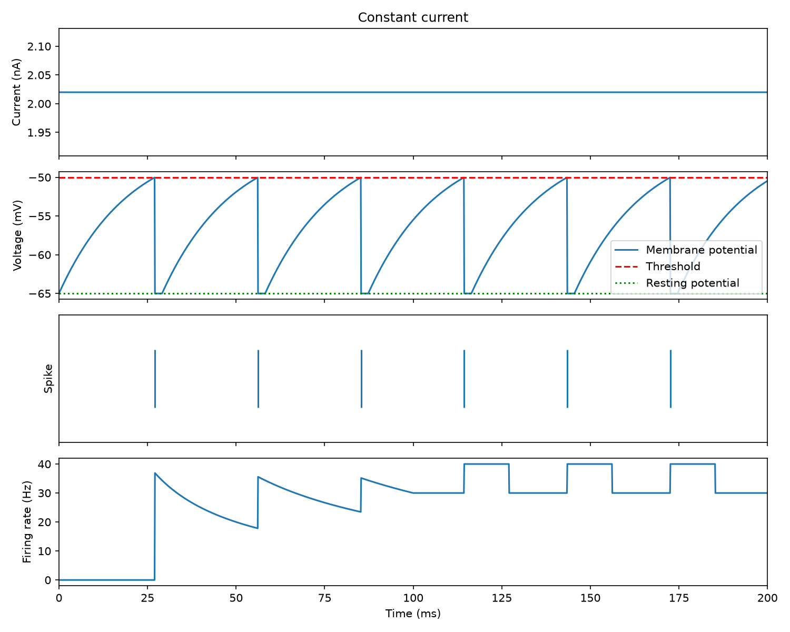
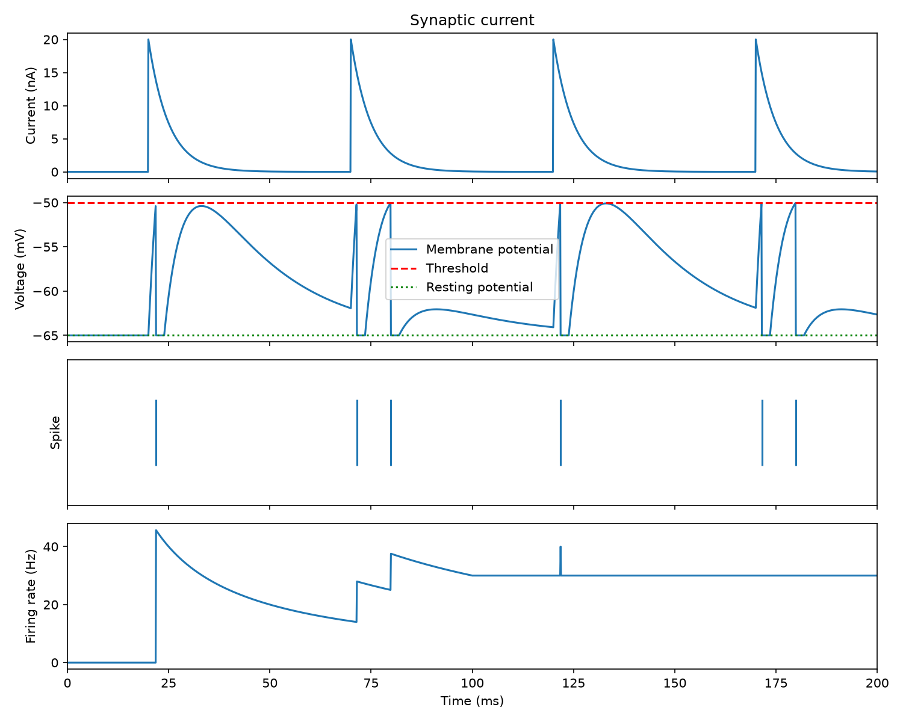

# 突触电流对照结果

仿真时长 2000 ms，步长 0.1 ms。从 20 ms 起每隔 50 ms 触发一次幅度 20 nA、衰减时间常数 5 ms 的指数电流；恒定输入取该离散突触电流的全程平均值。神经元参数见 parameters.json。

| 输入 | 平均电流 (nA) | 脉冲数 | 平均发放率 (Hz) |
| --- | --- | --- | --- |
| 恒定 | 2.01994148 | 68 | 34.0 |
| 指数突触 | 2.01994148 | 60 | 30.0 |

相同平均电流不保证相同发放：瞬时输入、膜泄漏、阈值和不应期共同影响输出。当前参数下突触输入的脉冲数较少，不能推广为所有突触参数下都如此。图片显示前 200 ms，统计覆盖全程。

