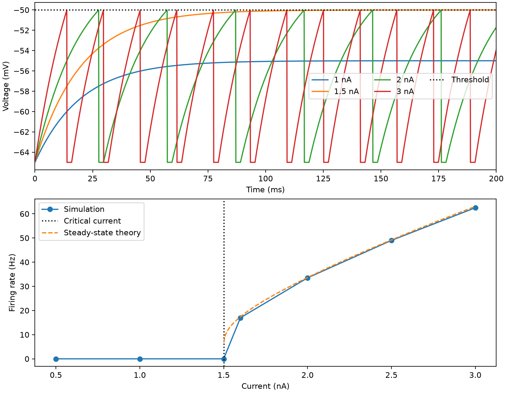

# 输入电流实验结果

固定阈值 -50 mV、静息电位 -65 mV、R=10 MΩ、tau=20 ms、不应期 2 ms，步长 0.1 ms，仿真 2000 ms。

| 电流 (nA) | 脉冲数 | 平均频率 (Hz) | 平均 ISI (ms) |
| --- | --- | --- | --- |
| 0.5 | 0 | 0 | — |
| 1.0 | 0 | 0 | — |
| 1.5 | 0 | 0 | — |
| 1.6 | 34 | 17.0 | 57.4 |
| 2.0 | 67 | 33.5 | 29.7 |
| 2.5 | 98 | 49.0 | 20.3 |
| 3.0 | 125 | 62.5 | 15.9 |

临界电流为 (V_th−V_rest)/R=1.5 nA；等于临界值时理论上渐近接近阈值，不产生有限时刻的发放。超过临界值后电流越强，ISI 越短。

稳态频率为 1000/[t_ref−tau ln(1−I_c/I)]，并非线性函数；强输入下趋向不应期决定的上限。仿真采用离散步长和有限窗口，计数频率与稳态理论会有小差异。

