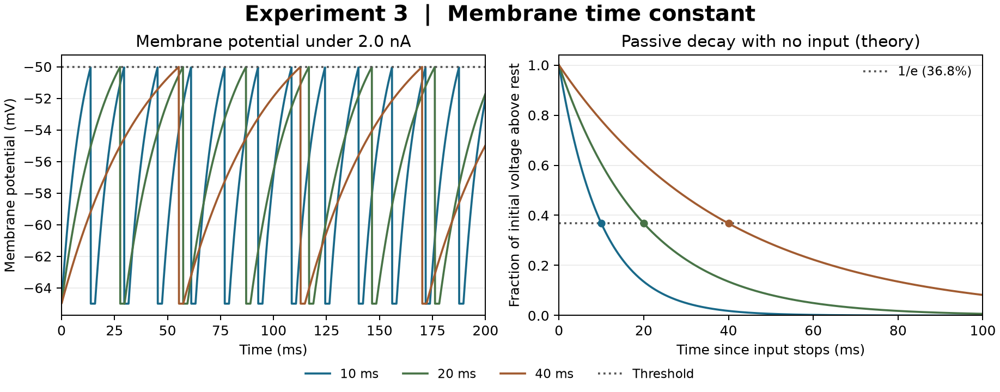

# 膜时间常数实验结果

固定电流 2 nA、阈值 -50 mV，其余参数见 parameters.json，独立仿真 2000 ms。

| tau (ms) | 脉冲数 | 平均发放率 (Hz) | 首发 (ms) | 平均 ISI (ms) |
| --- | --- | --- | --- | --- |
| 10 | 126 | 63.0 | 13.8 | 15.8 |
| 20 | 67 | 33.5 | 27.7 | 29.7 |
| 40 | 34 | 17.0 | 55.4 | 57.4 |

tau 越大，积分与被动衰减越慢，首发推迟，频率降低。tau=RC；无输入时高于静息电位的偏差经过 tau 后降至原来的 1/e。图左为仿真，右为解析衰减；计数使用完整 2 s，图只展示前 200 ms。CSV 时间保留一位小数。

