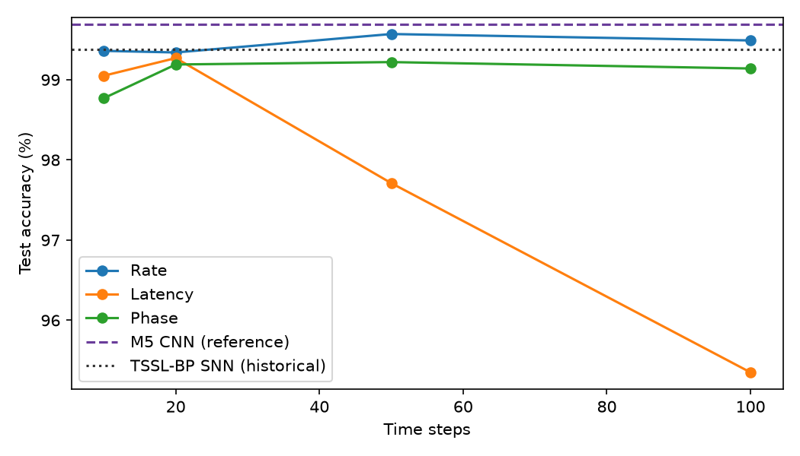
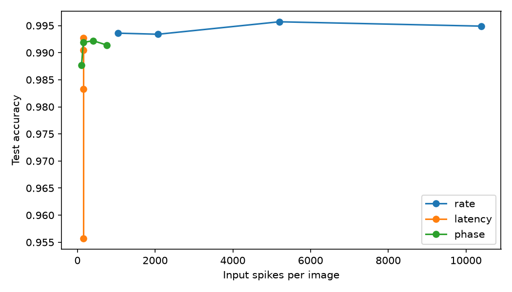

# Task 2：脉冲编码对分类性能的影响

## 1. 网络、数据与训练

- **模型**：采用 [TSSL-BP（Zhang 与 Li，NeurIPS 2020）](https://papers.nips.cc/paper/2020/hash/8bdb5058376143fa358981954e7626b8-Abstract.html) 的网络结构，各组参数量相同。
- **数据**：MNIST 训练／验证集为 50,000／10,000，使用相同的数据增强、EMA 和 seed 42；按验证集准确率选模，在官方测试集评估。
- **训练**：每组至少 20 轮，验证准确率连续 10 轮不提升时早停；部分实验手动停止，实际训练轮数不同。
- **训练环境**：snnTorch 1.0.0；RTX 5070 Ti Laptop GPU（Windows、Python 3.12.10、PyTorch 2.11.0+cu128）、V100 和 A800（Linux、Python 3.10.12、PyTorch 2.5.1+cu121）。
- **性能测试环境**：同一张 Tesla V100-PCIE-32GB，Linux、Python 3.10.12、PyTorch 2.5.1+cu121、snnTorch 1.0.0；使用 Inductor，batch size 20。

网络结构见[原论文表 1](https://papers.nips.cc/paper/2020/file/8bdb5058376143fa358981954e7626b8-Paper.pdf#page=8)：`15C5-P2-40C5-P2-300`。

## 2. 时间步数

每种编码分别设置 10、20、50、100 个时间步。

## 3. 指标比较

### 3.1 测试准确率

| 编码 | 10 步 | 20 步 | 50 步 | 100 步 |
|---|---:|---:|---:|---:|
| Rate | 99.36% | 99.34% | 99.57% | 99.49% |
| Latency | 99.05% | 99.27% | 98.33% | 95.57% |
| Phase | 98.77% | 99.19% | 99.22% | 99.14% |

**不同编码方式是否影响分类性能？为什么？**

本次结果有明显差异：100 步时，Rate、Phase、Latency 的准确率分别为 99.49%、99.14%、95.57%。三种编码分别通过发放频率、周期内的发放时刻和首次发放时刻传递信息，会改变膜电位的积累过程及训练时的时间依赖。长时间步下 Latency 的下降可能与输入脉冲分散、泄漏及优化难度有关，当前结果不能单独确定原因。

**增加时间步是否一定提高准确率？有什么代价？**

不一定。Rate 从 50 步的 99.57% 降至 100 步的 99.49%；Phase 从 50 步的 99.22% 降至 100 步的 99.14%。更多时间步还增加计算和状态更新：Rate 的纯模型每批耗时从 10 步的 0.76 ms 增至 100 步的 10.93 ms。

### 3.2 脉冲数量

每张测试图像的平均脉冲数：

**输入层**

| 编码 | 10 步 | 20 步 | 50 步 | 100 步 |
|---|---:|---:|---:|---:|
| Rate | 1,039 | 2,078 | 5,195 | 10,389 |
| Latency | 151 | 151 | 151 | 151 |
| Phase | 105 | 151 | 407 | 756 |

**第一隐藏层**

| 编码 | 10 步 | 20 步 | 50 步 | 100 步 |
|---|---:|---:|---:|---:|
| Rate | 5,316 | 9,396 | 20,974 | 37,257 |
| Latency | 1,794 | 2,096 | 11,541 | 28,141 |
| Phase | 1,932 | 2,173 | 6,076 | 9,327 |

**脉冲数量更少，是否一定意味着计算效率更高？**

不一定。输入层稀疏不代表隐藏层同样稀疏：Latency 输入层始终约 151 个脉冲／图，第一隐藏层却从 10 步的 1,794 个增至 100 步的 28,141 个。本实现使用稠密算子，零值不会自动省去相应计算；100 步下三种编码的纯模型每批耗时都约为 11 ms。脉冲数量也不能直接等同于能耗。

**静态视觉任务能否兼顾准确率、低延迟与稀疏性？**

我们采用的 TSSL-BP 网络结构提供了一个权衡基础：原论文在 MNIST 上使用 5 个时间步取得最高 99.53% 的准确率，并在其他数据集上观察到稀疏发放。其设计目标是缩短时间窗口，同时保持分类性能。这里借用其网络结构，训练使用 snnTorch，因此以下权衡以本实验结果为准。

现有结果中，Latency／20 是一种折中：准确率 99.27%，输入层和第一隐藏层平均约 151、2,096 个脉冲／图，纯模型每批耗时 0.94 ms。Rate／10 的准确率更高（99.36%）、耗时更短（0.76 ms），但脉冲更多（1,039、5,316 个／图）。因此没有一种配置在三项指标上都占优，应根据应用对精度、时延和活动量的要求选择。

### 3.3 推理时间

同一张 Tesla V100、batch size 20，使用 Inductor；预热后重复 10 次，报告纯模型前向平均每批耗时（毫秒），不含编译、输入编码和数据传输。模型采用稠密计算，未使用针对脉冲稀疏性的专门算子。

| 编码 | 10 步 | 20 步 | 50 步 | 100 步 |
|---|---:|---:|---:|---:|
| Rate | 0.76 | 0.91 | 4.51 | 10.93 |
| Latency | 0.78 | 0.94 | 4.45 | 10.96 |
| Phase | 0.78 | 0.93 | 4.66 | 10.99 |
