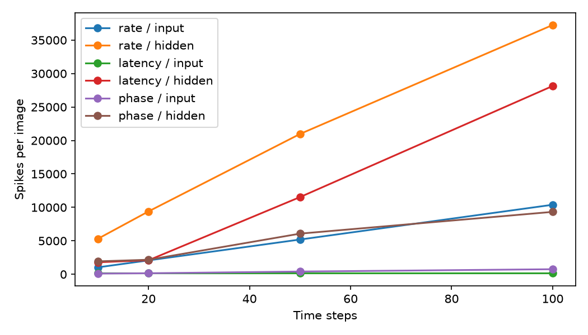

# Task 2：脉冲编码对分类性能的影响

## 1. 网络、数据与训练

模型采用 [TSSL-BP（Zhang 与 Li，NeurIPS 2020）](https://papers.nips.cc/paper/2020/hash/8bdb5058376143fa358981954e7626b8-Abstract.html) 的 MNIST 网络结构：两层卷积和池化，后接 300 单元全连接层与 10 类输出层；神经元使用 snnTorch 实现。

使用相同的 TSSL 结构、50,000／10,000 训练／验证集划分、数据增强和 EMA，比较 Rate、Latency、Phase 三种输入编码。实验使用 seed 42，按验证集准确率选择检查点，在 MNIST 官方测试集上评估。

各组至少训练 20 轮，以验证准确率连续 10 轮未提升为早停条件；部分实验手动停止，各组实际训练轮数不同。

## 2. 时间步数

每种编码分别设置 10、20、50、100 个时间步。

## 3. 指标比较

### 3.1 测试准确率

| 编码 | 10 步 | 20 步 | 50 步 | 100 步 |
|---|---:|---:|---:|---:|
| Rate | 99.36% | 99.34% | 99.57% | 99.49% |
| Latency | 99.05% | 99.27% | 98.33% | 95.57% |
| Phase | 98.77% | 99.19% | 99.22% | 99.14% |

### 3.2 脉冲数量

每张测试图像的平均脉冲数：

| 编码 | 时间步 | 输入层 | 第一隐藏层 |
|---|---:|---:|---:|
| Latency | 10 | 151 | 1,794 |
| Latency | 20 | 151 | 2,096 |
| Latency | 50 | 151 | 11,541 |
| Latency | 100 | 151 | 28,141 |
| Phase | 10 | 105 | 1,932 |
| Phase | 20 | 151 | 2,173 |
| Phase | 50 | 407 | 6,076 |
| Phase | 100 | 756 | 9,327 |
| Rate | 10 | 1,039 | 5,316 |
| Rate | 20 | 2,078 | 9,396 |
| Rate | 50 | 5,195 | 20,974 |
| Rate | 100 | 10,389 | 37,257 |

### 3.3 推理时间

同一张 Tesla V100、batch size 20，使用 Inductor；预热后重复 10 次，报告纯模型前向平均每批耗时（毫秒），不含编译、输入编码和数据传输。

| 编码 | 10 步 | 20 步 | 50 步 | 100 步 |
|---|---:|---:|---:|---:|
| Rate | 0.76 | 0.91 | 4.51 | 10.93 |
| Latency | 0.78 | 0.94 | 4.45 | 10.96 |
| Phase | 0.78 | 0.93 | 4.66 | 10.99 |

Latency／50 的时间使用第 63 轮检查点，准确率和脉冲数量使用第 66 轮检查点。

## 4. 实验曲线

## 5. 结果分析

- Rate 在 50 步达到 99.57%；Phase 在 50 步达到 99.22%。
- 输入 Spike 数越少，不一定意味着隐藏层也少。例如 Latency 的输入层平均约 151 个／图，100 步的第一隐藏层约 28,141 个／图。
- 增加时间步会增加本次测得的模型前向时间；Spike Count 不能直接等同于实际计算量或能耗。
