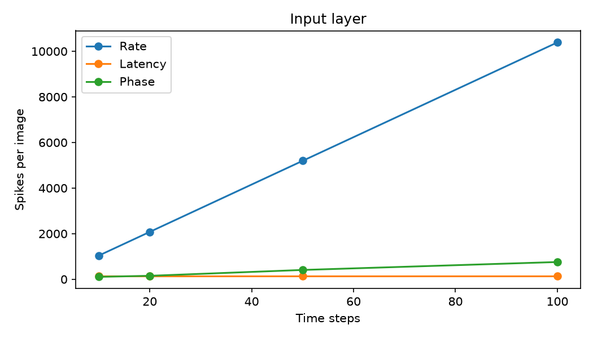
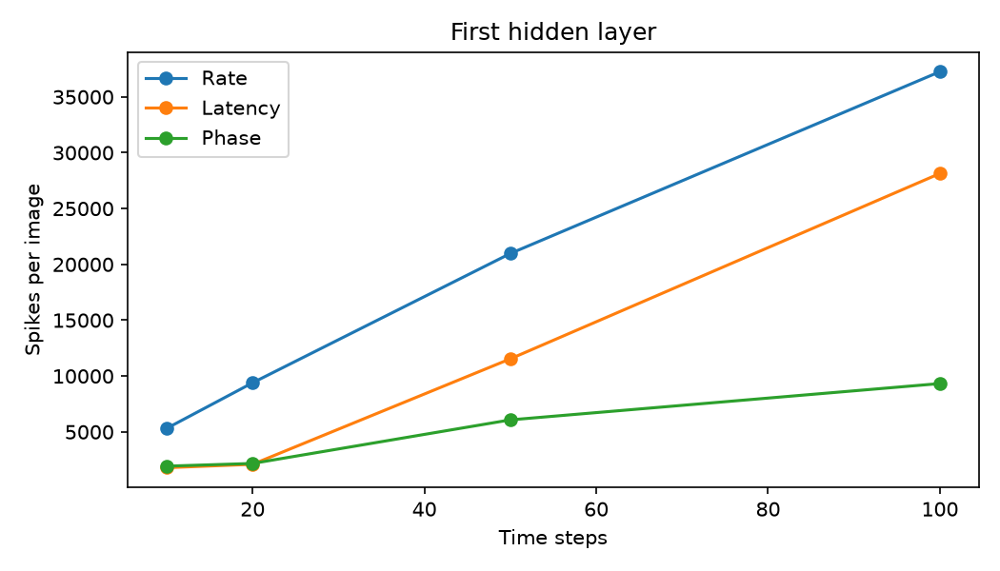

# Task 2：脉冲编码对分类性能的影响

## 1. 网络、数据与训练

- **模型**：采用 [TSSL-BP（Zhang 与 Li，NeurIPS 2020）](https://papers.nips.cc/paper/2020/hash/8bdb5058376143fa358981954e7626b8-Abstract.html) 的网络结构，各组参数量相同。
- **数据**：MNIST 训练／验证集为 50,000／10,000，使用相同的数据增强、EMA 和 seed 42；按验证集准确率选模，在官方测试集评估。
- **训练**：每组至少 20 轮，验证准确率连续 10 轮不提升时早停；部分实验手动停止，实际训练轮数不同。
- **环境**：snnTorch 1.0.0；训练使用 RTX 5070 Ti Laptop GPU（Windows、PyTorch 2.11.0+cu128）、V100 或 A800（Linux、PyTorch 2.5.1+cu121）。
- **推理时间**：统一在 Tesla V100 上使用 Inductor 和 batch size 20；预热后重复 10 次，取平均值。

模型结构：

## 2. 时间步数

每种编码分别设置 10、20、50、100 个时间步。

## 3. 指标比较

### 3.1 测试准确率

| 编码 | 10 步 | 20 步 | 50 步 | 100 步 |
|---|---:|---:|---:|---:|
| Rate | 99.36% | 99.34% | 99.57% | 99.49% |
| Latency | 99.05% | 99.27% | 98.33% | 95.57% |
| Phase | 98.77% | 99.19% | 99.22% | 99.14% |

### 3.2 脉冲数量

每张测试图像的平均脉冲数：

**输入层**

| 编码 | 10 步 | 20 步 | 50 步 | 100 步 |
|---|---:|---:|---:|---:|
| Rate | 1,039 | 2,078 | 5,195 | 10,389 |
| Latency | 151 | 151 | 151 | 151 |
| Phase | 105 | 151 | 407 | 756 |

**第一隐藏层**

| 编码 | 10 步 | 20 步 | 50 步 | 100 步 |
|---|---:|---:|---:|---:|
| Rate | 5,316 | 9,396 | 20,974 | 37,257 |
| Latency | 1,794 | 2,096 | 11,541 | 28,141 |
| Phase | 1,932 | 2,173 | 6,076 | 9,327 |

### 3.3 推理时间

同一张 Tesla V100、batch size 20，使用 Inductor；预热后重复 10 次，报告纯模型前向平均每批耗时（毫秒），不含编译、输入编码和数据传输。模型采用稠密计算，未使用针对脉冲稀疏性的专门算子。

| 编码 | 10 步 | 20 步 | 50 步 | 100 步 |
|---|---:|---:|---:|---:|
| Rate | 0.76 | 0.91 | 4.51 | 10.93 |
| Latency | 0.78 | 0.94 | 4.45 | 10.96 |
| Phase | 0.78 | 0.93 | 4.66 | 10.99 |

## 4. 实验曲线

## 5. 结果分析

- Rate 在 50 步达到 99.57%；Phase 在 50 步达到 99.22%。
- 输入 Spike 数越少，不一定意味着隐藏层也少。例如 Latency 的输入层平均约 151 个／图，100 步的第一隐藏层约 28,141 个／图。
- 增加时间步会增加本次测得的模型前向时间；Spike Count 不能直接等同于实际计算量或能耗。
